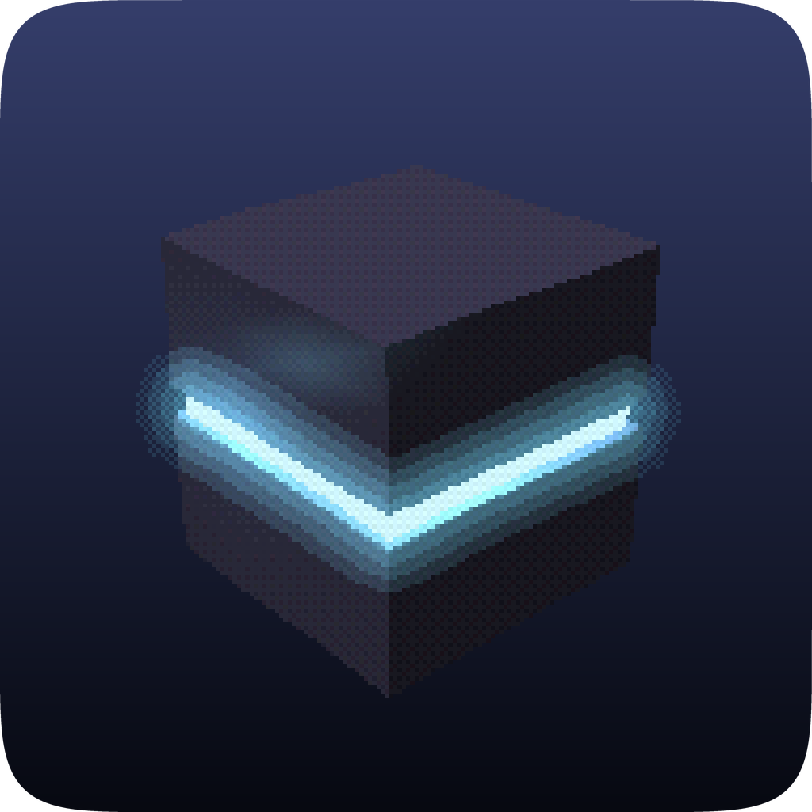

# Boxen app icon

**Reliquary**: a dark casket split by a seam of cold light. It's a low-poly object drawn the way a
PlayStation 1 drew it, with per-vertex lighting, snapped vertices, 15-bit colour with Bayer
dithering, and glow as stepped bands. It's presented in macOS Liquid Glass.



## What is source and what is generated

| File | Role | How it changes |
| --- | --- | --- |
| `reliquary.py` | **Source.** The scene: geometry, materials, lights, camera, the seam's width, and the background colour used for the previews. | Edit it, then run it. |
| `ps1_render.py` | **Source.** The PS1-style renderer the scene uses. | Edit it to change how anything is drawn. |
| `AppIcon.icon/icon.json` | **Source.** The Icon Composer composition: background fill, layer groups and order, Liquid Glass, specular, shadows, and the dark appearance. | Edit it in Icon Composer or by hand. `reliquary.py` never rewrites it. |
| `AppIcon.icon/Assets/*.png` | Generated by `reliquary.py`: `1-casket.png` (the casket and its glow) and `2-seam.png` (the seam alone). | Don't edit them. Re-run the script. |
| `Boxen.icns` | Generated by `reliquary.py`: a flattened icon on the classic macOS grid. `scripts/build-desktop.py` copies it into `Boxen.app`. | Don't edit it. Re-run the script. |
| `preview.png` | Generated by `reliquary.py`: the flattened icon at 1024 px, for reviewing changes. | Don't edit it. Re-run the script. |

The generated files are committed so the desktop build doesn't need Pillow or a renderer.

## Regenerating

```sh
python3 desktop/assets/app-icon/reliquary.py
```

This needs Python 3 and Pillow. `Boxen.icns` also needs macOS's `iconutil`; on other systems,
`--no-icns` regenerates everything else. The renderer is deterministic, so unchanged source gives
byte-identical layers.

## Layers in Icon Composer

The first group in `icon.json` renders on top:

1. **Seam** (`2-seam.png`): Liquid Glass and specular highlights are on, so the system's light
   catches only the light source. It has a shadow in the layer's own colour.
2. **Casket** (`1-casket.png`): Liquid Glass is off. Apple's guidance prefers flat, frontal art over
   realistic 3D because 3D can compete with the glass material, so the lit object stays as drawn
   and the glass treatment is limited to the seam.
3. **Background**: an automatic gradient built from `#232A4E`, and a deeper solid colour in the dark
   appearance.

The layers are square 1024 px images with no mask, as Apple requires: the system applies the
rounded shape.

## Current limits

- `Boxen.app` uses the flattened `Boxen.icns`. To use the Liquid Glass version, compile
  `AppIcon.icon` with Xcode 26 or later (`actool`) into the bundle's asset catalog. The desktop
  build doesn't do that yet.
- `icon.json` was written by hand against the format Icon Composer reads. It hasn't yet been
  opened in Icon Composer to check its rendering, the clear and tinted appearances, or the glass
  settings. Opening and saving it there may normalise the file; commit those changes.
